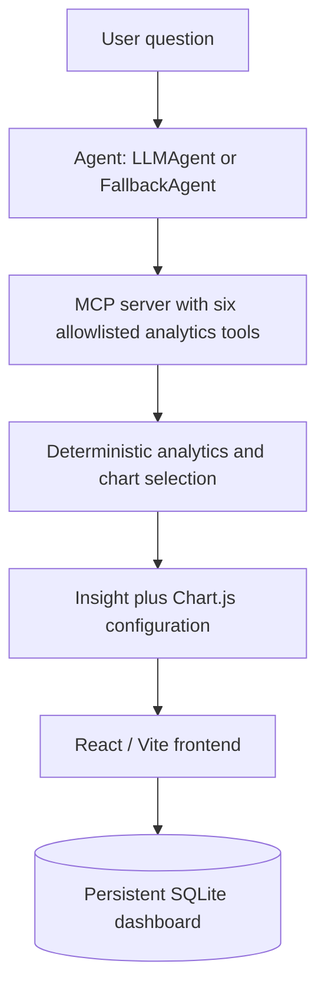

# CerebralZip Analytics

### E-commerce Analytics Chatbot for the Olist Brazilian E-Commerce Dataset

CerebralZip is an analytics chatbot that accepts plain-English questions, uses controlled MCP tools for data access, and returns deterministic Chart.js configurations plus factual one-sentence insights. Results can be pinned to a persistent, refreshable dashboard.

<p align="center">

  **[Live Demo](https://cerebralzip-analytics.vercel.app) · [GitHub Repository](https://github.com/Aarzoosagar/cerebralzip-analytics) · [Backend API](https://cerebralzip-analytics.onrender.com)**

</p>

---

## Table of Contents

- [Overview](#overview)
- [Key Highlights](#key-highlights)
- [Technology Stack](#technology-stack)
- [System Architecture](#system-architecture)
- [Live Deployment](#live-deployment)
- [Getting Started](#getting-started)
- [Environment Variables](#environment-variables)
- [Agent Modes](#agent-modes)
- [Dataset Bootstrap](#dataset-bootstrap)
- [API](#api)
- [MCP Tools](#mcp-tools)
- [Chart Selection](#chart-selection)
- [Demo Walkthrough](#demo-walkthrough)
- [Design Decisions](#design-decisions)
- [Known Limitations](#known-limitations)
- [Running Tests](#running-tests)
- [Author](#author)

---

## Overview

Ask a question such as *"Which product categories generate the most revenue?"* and CerebralZip selects the right analytics tools, runs predefined parameterized queries, picks a chart type from the shape of the data, and returns the chart configuration with a one-sentence insight. The LLM never executes arbitrary SQL.

### Key Highlights

- **Natural-language questions:** Plain-English queries answered with a chart and an insight.
- **Controlled data access:** Six allowlisted MCP tools with predefined, parameterized SQL.
- **Two interchangeable agents:** A Groq tool-calling `LLMAgent` and a deterministic rule-based `FallbackAgent`, with automatic fallback on recoverable failures.
- **Deterministic chart selection:** Chart type is chosen from data shape and always comes with a one-line justification.
- **Persistent dashboard:** Pin charts, refresh them by replaying stored tool calls, and detect significant changes.
- **One-command setup:** The app downloads the public Olist dataset and initializes SQLite on first start.
- **Automated testing:** pytest suite, with extra integration tests when a populated database is present.

---

## Technology Stack

| Layer | Technology |
|---|---|
| Backend | Python 3.11, FastAPI |
| Database | SQLite |
| Data loading | pandas, `app/database/loader.py` |
| Tool layer | Official Python MCP SDK (order, product, seller, review, payment, delivery tools) |
| LLM agent | Groq native tool calling (default model `llama-3.1-8b-instant`) |
| Fallback agent | Deterministic keyword and phrase matching |
| Frontend | React, Vite, Chart.js |
| Testing | pytest |
| Containers | Docker Compose |
| Deployment | Vercel (frontend), Render (backend) |
| Version control | Git and GitHub |

---

## System Architecture



`LLMAgent` and `FallbackAgent` implement the interchangeable `ILLMAgent` interface. The LLM agent uses Groq native tool calling. Recoverable LLM failures (timeout, missing key, API error, exhausted tool-call rounds) automatically invoke the deterministic fallback agent.

---

## Live Deployment

| Component | URL |
|---|---|
| Live application | https://cerebralzip-analytics.vercel.app |
| Backend service | https://cerebralzip-analytics.onrender.com |
| Health check | https://cerebralzip-analytics.onrender.com/health |
| Dashboard API | https://cerebralzip-analytics.onrender.com/api/dashboard |
| Source code | https://github.com/Aarzoosagar/cerebralzip-analytics |

---

## Getting Started

### Option 1: Docker Compose (one command)

```bash
git clone https://github.com/Aarzoosagar/cerebralzip-analytics.git
cd cerebralzip-analytics
cp .env.example .env
```

Add your `GROQ_API_KEY` to `.env` if you want LLM mode, then start everything:

```bash
docker compose up --build
```

- Backend: http://localhost:8000
- Frontend: http://localhost:5173

On first backend startup, the app downloads the public Olist archive, extracts the CSVs, and initializes SQLite before serving requests. Initialized databases are reused, so later runs are fast. No manual step is needed beyond the optional API key. The backend exposes a readiness check at http://localhost:8000/health.

### Option 2: Local development

```bash
python -m venv .venv
source .venv/bin/activate          # Windows: .\.venv\Scripts\Activate.ps1
pip install -e ".[dev]"
cp .env.example .env
uvicorn app.main:app --reload
```

In a second terminal, start the frontend:

```bash
cd frontend
npm install
npm run dev
```

The frontend's API base defaults to `http://localhost:8000` and can be changed with `VITE_API_BASE_URL`.

---

## Environment Variables

`.env` is git-ignored. Do not commit secrets.

| Variable | Default | Description |
|---|---|---|
| `AGENT_MODE` | `llm` in `.env.example`, `fallback` in Compose when unset | Preferred agent: `llm` or `fallback` |
| `GROQ_API_KEY` | Empty | Only required for LLM mode. Leave empty for automatic fallback or `AGENT_MODE=fallback` |
| `LLM_MODEL` | `llama-3.1-8b-instant` | Groq model used for native tool calling |
| `LLM_TIMEOUT_SECONDS` | `20` | LLM request timeout before automatic fallback |
| `DATABASE_PATH` | `data/olist.db` locally, `/app/data/olist.db` in Compose | SQLite database path |
| `DATA_DIR` | Database parent directory | Runtime directory for CSV files and downloaded data |
| `DATASET_URL` | Version-pinned public Olist archive | Optional override for the dataset ZIP URL |
| `API_HOST` | `0.0.0.0` in Compose | FastAPI bind host |
| `API_PORT` | `8000` in Compose | FastAPI bind port |
| `FRONTEND_ORIGIN` | `http://localhost:5173` | Allowed frontend origin (CORS). For the deployed app use `https://cerebralzip-analytics.vercel.app` |
| `VITE_API_BASE_URL` | `http://localhost:8000` | Backend URL used by the frontend. For production use `https://cerebralzip-analytics.onrender.com` |

---

## Agent Modes

**`AGENT_MODE=llm`:** Uses Groq native function calling and dispatches operations through the MCP tools. Timeouts, missing LLM configuration, recoverable Groq/API failures, network failures, and exhausted tool-call rounds automatically run the fallback agent. The response preserves `fallback_used` and `fallback_reason` metadata.

**`AGENT_MODE=fallback`:** Uses the deterministic rule-based agent directly and never calls the LLM. This mode is fully reproducible and recommended for grading or any environment without reliable LLM access.

---

## Dataset Bootstrap

Source: the official [Brazilian E-Commerce Public Dataset by Olist](https://www.kaggle.com/datasets/olistbr/brazilian-ecommerce). The default archive URL is:

```text
https://www.kaggle.com/api/v1/datasets/download/olistbr/brazilian-ecommerce?datasetVersionNumber=2
```

This public archive does not require Kaggle CLI authentication, browser login, cookies, API tokens, or credentials. It contains the nine expected files:

- `olist_customers_dataset.csv`
- `olist_geolocation_dataset.csv`
- `olist_order_items_dataset.csv`
- `olist_order_payments_dataset.csv`
- `olist_order_reviews_dataset.csv`
- `olist_orders_dataset.csv`
- `olist_products_dataset.csv`
- `olist_sellers_dataset.csv`
- `product_category_name_translation.csv`

`app/database/bootstrap.py` downloads and safely extracts the archive into `DATA_DIR`, then calls `load_olist_dataset()`. Initialization is idempotent: missing, empty, incomplete, or invalid databases are (re)loaded, while an initialized database with populated orders is reused. CSVs, ZIP archives, and the SQLite database are runtime artifacts ignored by Git.

---

## API

| Method | Path | Purpose |
|---|---|---|
| `GET` | `/health` | Backend liveness check |
| `POST` | `/api/query` | Analyze a question and return chart, insight, and metadata |
| `GET` | `/api/dashboard` | List persisted dashboard items |
| `POST` | `/api/dashboard/pin` | Persist a successful chart analysis |
| `POST` | `/api/dashboard/{item_id}/refresh` | Replay stored tool calls and refresh an item |
| `DELETE` | `/api/dashboard/{item_id}` | Remove a persisted dashboard item |

Dashboard records retain the question, agent mode, structured tool calls, chart snapshot, analytics result, insight, and timestamps in SQLite. Refresh compares the new snapshot against the previous one and preserves the prior item if the refresh returns empty data or fails.

When running locally, interactive API docs are available at http://127.0.0.1:8000/docs.

```bash
curl http://127.0.0.1:8000/health
```

---

## MCP Tools

The official MCP 2.x Python SDK server exposes six structured tools:

`order_trends` · `product_performance` · `seller_performance` · `review_analysis` · `payment_breakdown` · `delivery_performance`

All SQL is predefined, parameterized, and constrained by allowlisted metrics, grouping, dates, limits, and sorting. The LLM never executes arbitrary SQL.

- Product and category results are always joined against `product_category_name_translation`.
- Delivery delay is the actual delivery timestamp minus the estimated delivery date; orders without an actual delivery timestamp are excluded.
- Seller review scores are deduplicated at the order/seller level so multi-item orders don't inflate review counts.

---

## Chart Selection

| Data shape | Chart type |
|---|---|
| Single metric over time | Line chart |
| Two metrics over the same time axis | Dual-axis line chart |
| Ranked top-N results | Horizontal bar chart, sorted descending |
| Category comparison in a single period | Vertical bar chart |
| Order-volume/category + review comparison | Two-dataset bar chart, separate axes |
| Delivery-delay/state + review comparison | Horizontal two-dataset bar chart, separate axes |
| Part-to-whole (e.g. payment type share) | Doughnut chart |
| Two continuous variables per entity | Scatter chart |
| Review-score distribution (1–5) | Stacked horizontal bar chart |

The chart type and a one-line justification are always included in the `/api/query` response. If the data shape is genuinely ambiguous, two chart options are returned instead of one.

---

## Demo Walkthrough

Run these five queries in order to exercise the core single-tool paths:

1. `Show monthly revenue trend in 2017` — time-series line chart.
2. `Which product categories generate the most revenue?` — ranked horizontal bar with translated category names.
3. `Which states have the worst delivery performance?` — ranked delivery-delay bar chart.
4. `What share of payments are credit card vs boleto?` — payment-share doughnut chart.
5. `Top 10 sellers by revenue in São Paulo` — filtered, ranked seller bar chart.

Additional multi-tool examples:

- `Compare review scores across the top 5 categories by order volume`
- `Show monthly orders and average review score together for 2017`
- `Do sellers with faster delivery get better reviews?`
- `Show delivery delay and review score side by side by state`

---

## Design Decisions

**Chart type selection.** Chart type is chosen from data shape, not randomly. Every response includes the chart type plus a one-line justification, and genuinely ambiguous shapes return two options instead of guessing.

**Refresh and significant-change detection.** Pinning a chart stores its exact structured tool calls, not just its rendered output. Refreshing replays those calls against the current database and diffs the result against the stored snapshot using metric-specific thresholds:

- roughly 10% relative change for most aggregate metrics
- 5 percentage points for share-of-total metrics (such as payment mix)
- 0.3 points for average review score
- 1 day for delivery delay

If a refresh returns no data or fails, the previous snapshot is preserved, so a transient failure can't silently blank a pinned chart.

**What the fallback agent does differently.** `FallbackAgent` never calls an LLM. It uses deterministic keyword and phrase matching to select the required MCP tools and extract supported parameters. The final chart type comes from the same deterministic chart-selection logic used by the LLM path, so supported queries can produce line, bar, doughnut, stacked-bar, or scatter visualizations. This makes fallback mode reproducible and useful when LLM access is unavailable or unreliable.

---

## Known Limitations

- LLM-based tool selection can be affected by model behavior and may occasionally need a retry if the model selects an unintended tool. Fallback mode is available for reproducible execution.
- Natural-language date interpretation is guided by the system prompt and fallback rules, but LLM output can still be non-deterministic. If a date range looks wrong, rerun the query or use fallback mode.

---

## Running Tests

Run the complete suite from the repository root:

```bash
python -m pytest -q
```

The number of tests that run depends on whether `data/olist.db` is already populated: a real database unlocks additional integration tests that are otherwise skipped.

---

## Author

**Aarzoo Sagar**

- GitHub: [@Aarzoosagar](https://github.com/Aarzoosagar)
- Project: [CerebralZip Analytics](https://github.com/Aarzoosagar/cerebralzip-analytics)

---

## License

No license is specified in this README. Check the repository for an existing license before adding one.
